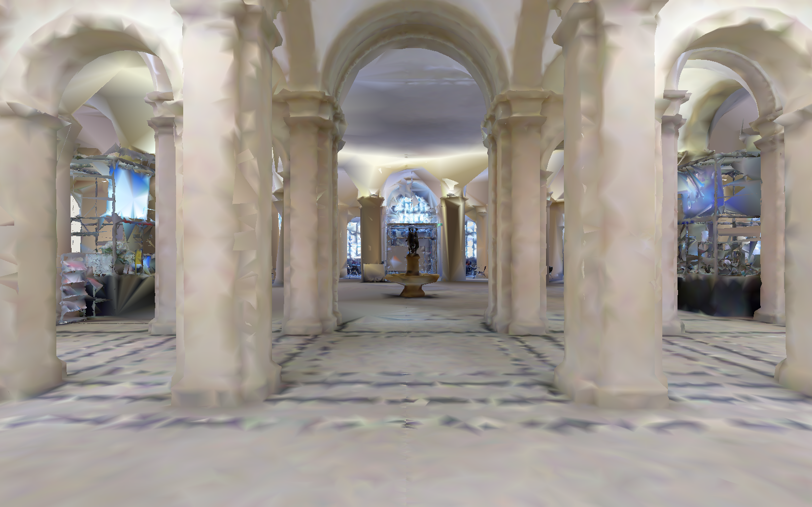
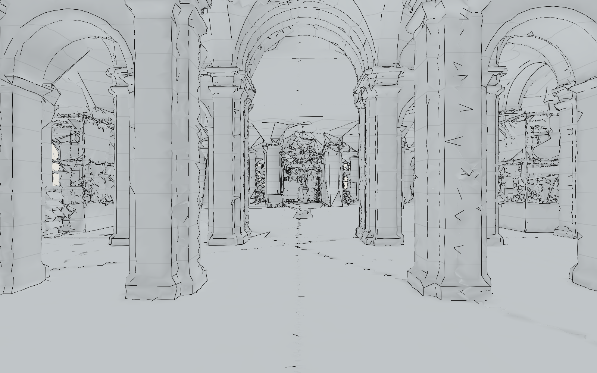
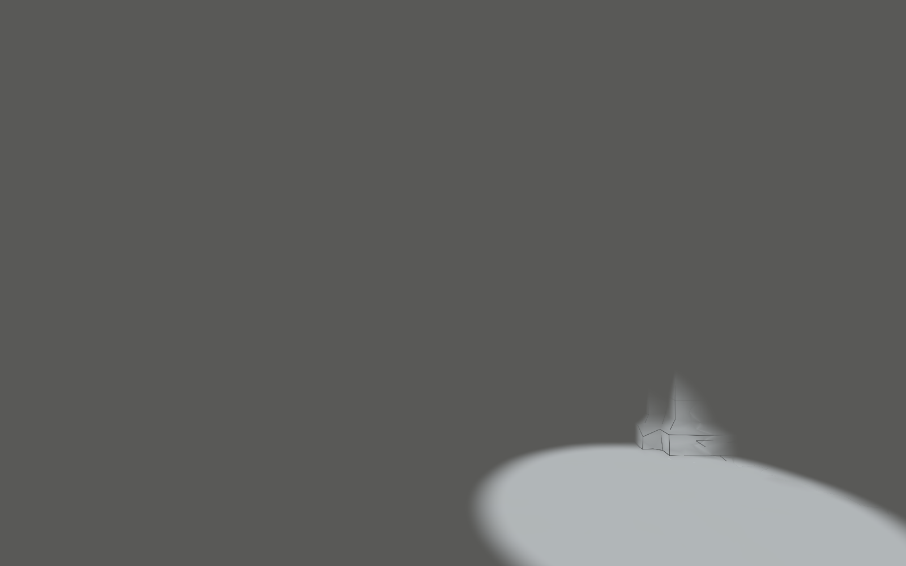
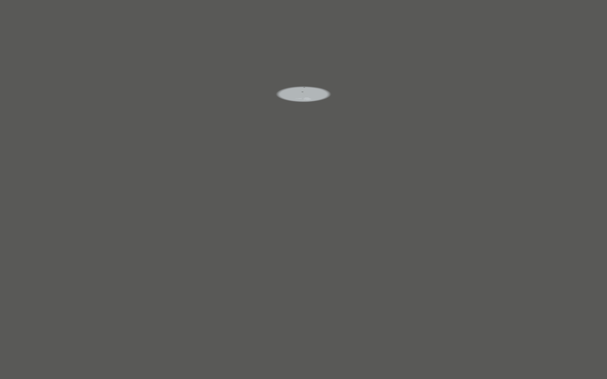
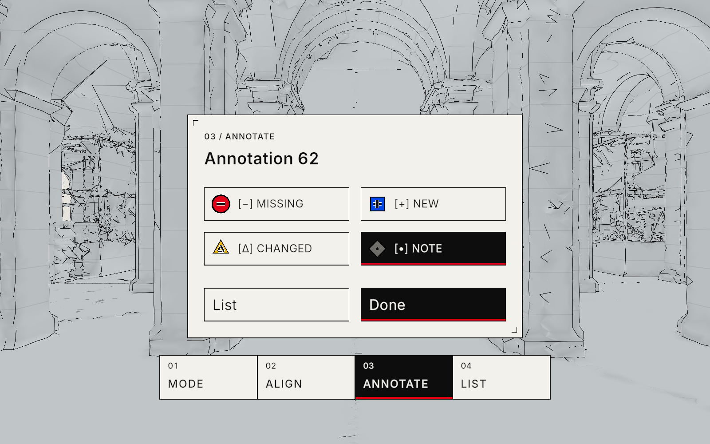
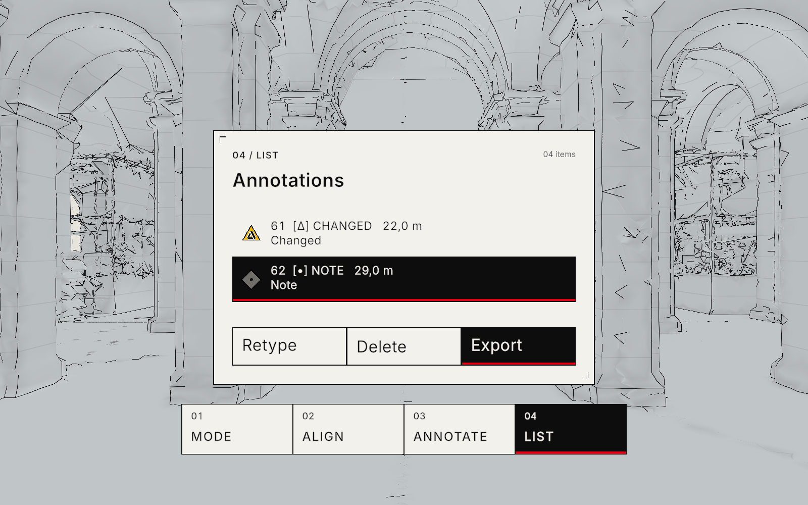

# TwinInspector

TwinInspector is a Unity application for inspecting a scanned building on Samsung Galaxy XR. It combines a digital twin with camera passthrough, supports manual and surveyed-marker alignment, and stores inspection notes in the building's original coordinate frame. The same project runs in the Unity Editor with a mouse and keyboard.

**Version 1.2** · Android XR · Unity 6000.3.26f1

[Download the APK](TwinInspector/Builds/TwinInspector-0.1.0.apk?raw=true) · [Setup and development guide](TwinInspector/README.md) · [Development notes](TwinInspector/docs/DEVLOG.md)


*The inspection panel sits above the tool strip in a shared world-space dock. All images on this page are captures from the Unity Editor.*

## Inspection workflow

The four tool sections cover comparison, registration and annotation. Setup provides handedness and feedback preferences; Diagnostics shows the available runtime measurements.

| Section | Use |
| --- | --- |
| **01 Mode** | Switch between Reality, Twin and Overlay. Choose Colour or Technical rendering, adjust opacity, or enable the local inspection Lens. |
| **02 Align** | Register the twin with a single-hand drag, optional two-hand translation/yaw, measured marker poses, or numerical adjustments. Height is locked by default. |
| **03 Annotate** | Place a surface note and classify it as Missing, New, Changed or Note. Each type has its own shape and symbol. |
| **04 List** | Review annotations, select or retype an item, delete it, and export JSON or CSV. |

In Twin mode, the Roam page provides movement and snap turns. Returning to Overlay or Reality restores the physical inspection frame; roaming does not alter saved building alignment.

## Architectural views

Colour retains the scan's sampled colours. Technical uses restrained surface shading, crease and silhouette lines, and elevation contours at 0.5 m intervals. Both views use the same measured geometry, including its reconstruction defects.

| Colour | Technical |
| --- | --- |
|  |  |

The datum grid uses 1 m crosshair ticks and 10 m major lines. It follows the building's original coordinates and appears in Twin mode and during manual alignment.

Lens is an optional Overlay control. It reveals the twin inside a sphere around the pointed surface, with a default radius of 1.5 m and an adjustable range of 0.5–5 m. The last position is retained while operating the controls; losing the surface briefly holds and then fades the reveal.

| Lens at a nearby surface | Lens at a distant surface |
| --- | --- |
|  |  |

*The sphere has the same physical radius in both captures. Grey outside the reveal is the Editor background, not a headset passthrough recording.*

## Annotations and interaction

Annotations retain their surface position, normal and stable ID when their display size changes. Glyphs and labels face the viewer and remain readable at inspection distances; their selection targets are independent of the building mesh. Type identity uses both geometry and text:

| Type | Glyph | Colour |
| --- | --- | --- |
| Missing | Circle with a minus | Red |
| New | Square with a plus | Blue |
| Changed | Triangle with a delta | Yellow |
| Note | Diamond with a dot | Grey |

| Type selection | Annotation list |
| --- | --- |
|  |  |

Hands use pointing and pinch, with near poke for UI. Optional controllers use the same interaction path. Either hand can summon the dock with a brief palm-up gesture and then operate it. A persistent dominant-hand preference selects the default pointer without requiring that hand to remain tracked. Sound can be adjusted or muted without losing visual feedback.

## Run the application

### Unity Editor

1. Clone this repository and open the **`TwinInspector` folder** in Unity **6000.3.26f1**. Keep the committed package versions.
2. Open `Assets/_TwinInspector/Scenes/Inspector.unity`.
3. Enter Play mode and focus the Game view. The packaged 32-tile hall demo loads when the configured external dataset is unavailable.

No XR Device Simulator key combinations are needed for desktop testing.

| Input | Action |
| --- | --- |
| Right mouse + mouse movement | Look around |
| W / A / S / D | Move horizontally |
| E / Q or Space / Left Shift | Move vertically |
| Alt; right mouse + scroll | Increase or adjust movement speed |
| Left mouse | Operate UI or place/select an annotation |
| 1 / 2 / 3 / 4 | Mode / Align / Annotate / List |
| Tab | Summon and recenter the dock |
| M | Simulate the first marker entry for Editor testing |

### Samsung Galaxy XR

Enable USB debugging on the headset, connect it to the development computer, and accept the authorization prompt. With Android SDK platform tools on your path, run these commands from the repository root:

```powershell
adb devices -l
adb install -r TwinInspector/Builds/TwinInspector-0.1.0.apk
adb shell am start -n com.mrtwin.inspector/com.unity3d.player.UnityPlayerGameActivity
```

Grant the requested camera, scene-understanding and hand-tracking permissions. The APK includes the hall demo; external scan data is optional for the first run. See the [project guide](TwinInspector/README.md#headset-setup-and-data-transfer) for full-region transfer and surveyed-marker setup.

The APK filename is retained for compatibility with the existing delivery scripts. Its application version is **1.2.0**, package ID is **`com.mrtwin.inspector`**, and size is **66.37 MB / 63.29 MiB**. Installing with `-r` updates the existing application while preserving its data. Repository access is required to download this private build.

SHA-256:

```text
bf4e2daafa8afc507413752684df6590251254ec5eac60e537de70de593e6030
```

## Verification status

The v1.2 build was checked on 15 October 2026.

| Check | Result |
| --- | --- |
| C# compilation | 0 errors, 0 warnings |
| Shader compilation | 0 errors |
| Android OpenXR project validation | 0 issues |
| Unity tests | 16 passed |
| Desktop interaction | Mouse UI, placement, flight and shortcuts passed |
| Synthetic XRI workflows | Left hand, right hand, left controller and right controller passed independently |
| Persistence and export | Annotation save/reload and JSON/CSV export passed |
| Android package | Build succeeded; ARM64 IL2CPP and all 32 bundled tile hashes verified |

The build reports one existing warning about the Pipeline Editor control service being disabled in the player. No headset was connected during this verification. Physical hand/controller tracking, near poke, both-eye rendering, runtime OpenXR logs, anchor relocalization and device performance still need a headset acceptance run. The **72 FPS minimum, 90 FPS target and 300-draw-call budget are targets, not measured results**.

Detailed [test evidence](TwinInspector/docs/evidence/), [screenshots](TwinInspector/docs/screenshots/) and the [device acceptance procedure](TwinInspector/README.md#device-acceptance-run) are included in the repository.

## Repository layout

```text
TwinInspector/                       Unity project
  Assets/_TwinInspector/             Application code, shaders, prefabs and scene
  Assets/StreamingAssets/twin_demo/   Packaged hall demo
  Builds/TwinInspector-0.1.0.apk      Installable v1.2 build
  docs/                              Development notes and verification evidence
tools/                               Scan processing, deployment and Unity checks
```

Raw scans, intermediate meshes, Unity caches and local working data are excluded from Git. The [project guide](TwinInspector/README.md) documents the coordinate conventions, build process and external tile pipeline.

## Credits

The hall geometry is derived from the **LaMAR HGE** dataset by ETH Zurich and Microsoft, scan `navvis_2022-02-06_12.55.11`. Redistributed tiles retain **CC BY-SA 4.0**; the [bundled notice](TwinInspector/Assets/StreamingAssets/twin_demo/LICENSE.txt) records the source and processing changes.

The interface uses **Inter 4.1** by Rasmus Andersson under the SIL Open Font License. Unity, Google XR and other dependency notices remain with their packages and imported samples.
