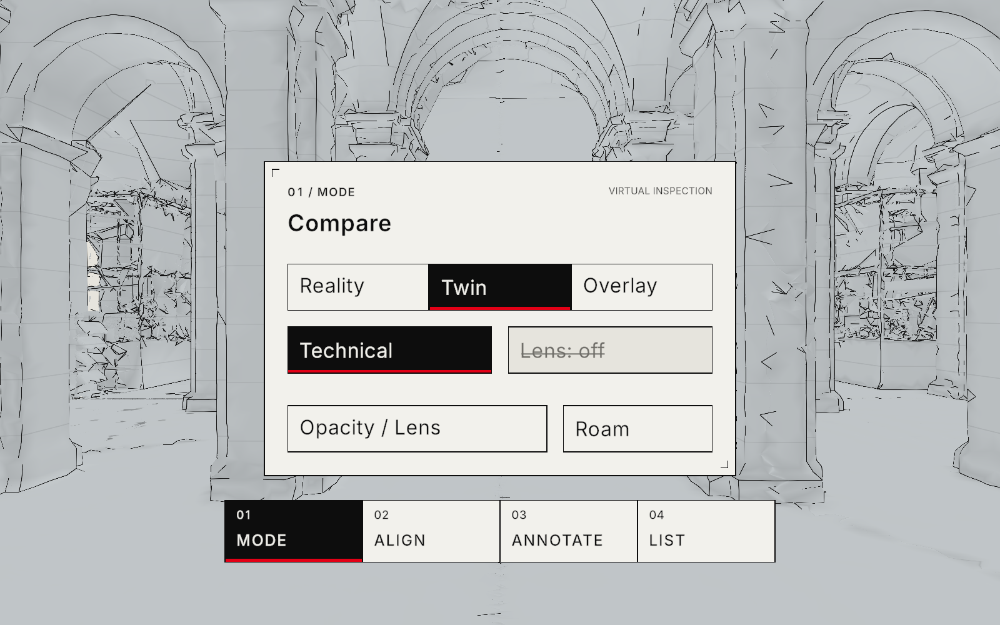

# TwinInspector — setup and development

This guide covers the Unity project, controls, Android deployment and external scan data. For an illustrated overview, see the [repository README](../README.md).

TwinInspector v1.2 uses Unity **6000.3.26f1**, XRI **3.6.1**, OpenXR, URP and glTFast. The Android application version is **1.2.0**, with package ID `com.mrtwin.inspector`. The [tracked APK](Builds/TwinInspector-0.1.0.apk) includes a 32-tile hall demo and can update an existing installation with `adb install -r`, preserving saved data. The existing filename is retained by the delivery scripts. External scans, caches and other build outputs are excluded from Git.



*Unity Editor capture. The panel and strip share a world-space dock.*

See [DEVLOG](docs/DEVLOG.md) for build and verification results. Editor and synthetic input checks do not establish physical tracking, stereo correctness or headset frame rate.

Verified v1.2 APK: **66,366,495 bytes (63.29 MiB)**; SHA-256 `bf4e2daafa8afc507413752684df6590251254ec5eac60e537de70de593e6030`. Compilation has zero errors/warnings, all 16 Unity tests pass, and Android OpenXR project validation has zero issues. No headset was connected for device acceptance.

## Prepare the data

The packaged demo is sufficient to try the application. Process external data only when a full region is needed. The commands below use the development laptop's checkout and `mr` Python environment; adjust those paths on another machine. Python dependencies are listed in [requirements-twin.txt](../tools/requirements-twin.txt).

```powershell
& 'D:\miniforge3\envs\mr\python.exe' -I tools\tests\test_twin_pipeline.py
& 'D:\miniforge3\envs\mr\python.exe' -I tools\twin_pipeline.py all --session dataset\raw\HGE\sessions\navvis_2022-02-06_12.55.11 --region a --out work\twin\HGE_2022-02-06\region_a
& 'D:\miniforge3\envs\mr\python.exe' -I tools\verify_seams.py work\twin\HGE_2022-02-06\region_a
& 'D:\miniforge3\envs\mr\python.exe' -I tools\verify_tiles.py work\twin\HGE_2022-02-06\region_a
```

Repeat with `--region b` and `--out work\twin\HGE_2022-02-06\region_b` for the floor. Regions A and B use fixed measured extents rather than semantic indoor segmentation. Centroid clipping retains complete boundary triangles; a triangle can extend outside its cell or region.

The pipeline reads fixed-size PLY batches through read-only memory maps. Checkpointed batches and completed tiles are skipped on rerun. The `config.json` fingerprint rejects a different source/configuration in an existing output. Choose a new output directory for changed settings. `--force` reruns the selected stage; `all --force` rebuilds all stages. Do not run two writers against the same output directory. `--target-ratio` defaults to 0.013 and is reduced automatically if the region triangle budget would be exceeded.

Each compact tile is simplified as a whole up to eight million triangles. Larger tiles use spatial median splits. v1.1 disables independent vertex welding and enables `fast_simplification` 0.2.0 `preserve_border=True` at every reduction. Centroid cuts create zig-zag shared edges that are not necessarily on a 10 m grid plane; preserving only modulo-grid vertices would miss them. Open boundary vertices and edges remain exact across all LODs. Lower LOD triangle ratios may therefore be exceeded; the manifest records the exact excess and boundary policy. The 1.5 M / 5 M regional LOD0 budgets remain hard limits.

Run `tools/verify_seams.py <output>` before `tools/verify_tiles.py <output>`. The seam verifier independently compares every exported GLB against the source chunk's open edges, with a 20 micrometre export-rounding tolerance and zero missing edges. v1.1 reduction checkpoints are versioned by boundary policy; old reductions are rebuilt automatically. The original Region B baseline is verified for geometry and budgets but has not been regenerated with the new seam policy.

Stages can be run separately: `chunk`, `simplify`, `export`, `manifest`, `preview`. Raw data and intermediate chunks stay outside the APK. The only bundled data is Region A LOD2, packaged with:

```powershell
& 'D:\miniforge3\envs\mr\python.exe' -I tools\package_demo.py work\twin\HGE_2022-02-06\region_a TwinInspector\Assets\StreamingAssets\twin_demo
```

## Coordinates

Persisted twin coordinates are aligned LaMAR world coordinates, metres, right-handed Z-up. Tiles subtract `origin_world = [20, 0, 0]`, then export `(x,y,z) → (x,z,-y)`. glTFast reflects X into Unity handedness. A single 180° Unity Y rotation on the imported tile container gives local `(x,z,y)`. The root applies only alignment; it never scales the building. The inverse is local `(x,z,y) + origin_world`. Python and C# tests use asymmetric points so a double reflection cannot silently pass. Confirm the rotunda remains west / negative X in the scene.

Annotations and measured marker coordinates always use the original twin frame, with the origin offset restored. Do not measure in the shifted glTF frame.

## Headset setup and data transfer

On the headset, open Settings → About headset → Software information, tap Build number seven times, then enable USB debugging in Developer options. Connect USB-C and accept the RSA prompt. `adb devices` must show an authorized device.

After installing and first launching the APK, push a verified region:

```powershell
.\tools\push_twin.ps1 -Region region_a
# Or region_b; -Serial selects a device when more than one is connected.
```

Only runtime GLBs, marker configuration and the manifest are transferred. Tiles go into a manifest-hash revision directory; the manifest is activated last, so interrupted transfers cannot replace files referenced by the previous manifest. Device destination: `/sdcard/Android/data/com.mrtwin.inspector/files/twin/HGE_2022-02-06/`. Previous tile revisions are retained. Restart the app after replacing a dataset. A missing external dataset uses a packaged selection of complete nearby Region A LOD2 tiles, capped below 15 MB. External data retains the entire region.

Grant the camera, scene-understanding and hand-tracking permissions. For marker alignment, print `tools/markers/marker_00.png` on A4 at 100%, check the black square is 150 mm, and place it at a surveyed pose. Follow the [marker measurement instructions](../tools/markers/README.md). Shipped coordinates are examples with `measured:false`; automatic headset alignment rejects them. A marker must remain tracked for one second before confirmation.

## Build, install and launch

Open `Assets/_TwinInspector/Scenes/Inspector.unity`. The scene uses the XRI modality manager with two hand groups and two optional controller groups. The Editor-only XR Device Simulator is disabled by default. The generated assets are committed; `TwinInspector → Rebuild application assets and Inspector` reproduces them through Editor APIs if needed. This command replaces Inspector, so save any intentional scene edits first.

From PowerShell at the repository root, using the development laptop's paths:

```powershell
$env:UNITY_NO_BANNER='1'
$env:UNITY_NON_INTERACTIVE='1'
$env:UNITY_NO_PAGER='1'
$unity='C:\Users\zackz\AppData\Local\Unity\bin\unity.exe'
$project='E:\MixedReality\TwinInspector'
& $unity recompile --project-path $project --timeout 300 --format json
& $unity command eval_file E:\MixedReality\tools\unity\validate.cs 60000 --timeout 120 --project-path $project --result-only
& $unity command build --target Android --outputPath Builds/TwinInspector-0.1.0.apk --confirm true --project-path $project --result-only
& $unity command build_status --project-path $project --result-only
```

Wait for the build status to complete successfully. Vulkan, IL2CPP, ARM64, GameActivity and the existing .NET Framework compatibility setting are retained. Forward+, Render Graph, 4× MSAA, foveation, GPU Resident Drawer and GPU occlusion are configured; HDR, shadows, post-processing and optional camera copies are disabled. Transparent overlay rendering is not eligible for every GPU Resident Drawer optimization; performance still requires headset measurement.

For an unattended build, start the closed project with `& $unity open $project --args='-batchmode'` before issuing the Pipeline commands. The project's Android build callback merges duplicate manifest entries generated by the Unity and Google XR packages, retaining the highest required spatial API version. Keep that callback; otherwise these package versions produce a duplicate-feature Gradle error.

```powershell
$adb='E:\Unity\Editor\6000.3.26f1\Editor\Data\PlaybackEngines\AndroidPlayer\SDK\platform-tools\adb.exe'
& $adb devices -l
& $adb install -r TwinInspector\Builds\TwinInspector-0.1.0.apk
& $adb shell am start -n com.mrtwin.inspector/com.unity3d.player.UnityPlayerGameActivity
& $adb logcat -s Unity
```

## Use in the Editor and on Galaxy XR

Enter Play mode in Inspector and focus the Game view. With no actively tracked HMD, the Editor selects mouse and keyboard automatically. The simulator stays disabled. The Editor loads `Settings.editorDataPath`; the packaged LOD2 demo is used when external data is absent.

| Action | Editor input |
|---|---|
| Look | Hold right mouse; yaw/pitch with zero roll |
| Move | W/A/S/D horizontally; E/Q or Space/Left Shift vertically |
| Speed | Hold Alt for 3× speed; right mouse + wheel adjusts base speed |
| Tool pages | 1 Mode, 2 Align, 3 Annotate, 4 List |
| Interact | Left click world-space buttons, sliders or an annotation surface |
| Recenter | Tab summons the active panel and recenters the strip |
| Marker simulation | M uses `markers.json` entry zero; this is an Editor fixture |
| Developer hints | Setup → Diagnostics shows PerfHud and the corner key guide |

On Galaxy XR, point and pinch to activate UI or place an annotation; near UI also accepts poke. A tracked controller uses its trigger through the same XRI action readers. The modality manager activates the tracked hand or controller group automatically; no controller model or long sample beam is rendered.

The numbered ToolStrip and active panel share a world-space dock: 0.55 m forward, 22° below eye level, a 25° heading dead zone and a 150 ms recenter. The panel remains centered **24 mm above** the strip. Targeting or manipulating a control suspends automatic movement. Briefly raise either available palm to summon the dock, then turn the same hand over to operate it; lowering the palm re-arms the gesture. Tab and Setup → Preferences → Recenter provide explicit alternatives.

- **00 Setup → Preferences:** persistent Left/Right dominant-hand preference, feedback sound and volume. The available hand always works when the preferred hand is absent. Visual feedback remains when muted.
- **01 Mode:** Reality / Twin / Overlay, Technical / Colour, and the Lens toggle. Opacity / Lens opens the blend and 0.5–5 m radius controls. Lens defaults off and is available in Overlay. Its sphere follows the stabilized building hit; UI retains the last center, while no-hit holds briefly and fades out.
- **01 Mode → Twin → Roam:** hold Forward / Backwards / Left / Right to move at 0.5 m/s; turn in 30° steps, or Return to room. Two-hand pinch world-drag remains available. Leaving Twin restores the physical inspection frame before comparison. Roaming never saves a building-registration offset.
- **02 Align:** enters Overlay, including from Reality or a roamed Twin view. Point at the building and pinch/drag with one hand; a second pinch adds translation/yaw. Height starts locked. Fine/coarse nudges, height controls, floor snap, surveyed marker confirmation and Save Alignment remain available. The interface shows the original-frame datum.
- **03 Annotate:** point at a visibly revealed building surface and select. Choose circle/minus Missing, square/plus New, triangle/delta Changed or diamond/dot Note. Geometry, high-contrast symbols and text identify types independently of color. Presentation faces the center-eye camera, while the stored surface anchor and normal remain unchanged.
- **04 List:** scroll, select, retype, delete and export original-frame JSON/CSV. Selection prioritizes visible, best-aligned annotations, with building occlusion and stable tie-breaking.
- **05 Diagnostics:** existing performance readings plus Editor-only corner key hints. Device metrics remain unavailable when no runtime supplies them.

The pointing filter acts on derived XRI ray transforms before hit testing, using the installed readers' continuous pinch/trigger value. A rising 0.4 strength crossing briefly increases angular damping; 0.3 re-arms it, and confirmation restores responsive dragging. These values and the 150 ms window are serialized tuning values on each inspection ray. Mouse pointing bypasses this filter.

Technical rendering caches mesh adjacency, area-weighted normals and restrained concavity at tile/LOD import. Creases and view-dependent silhouettes use screen-expanded ink segments; unpaired cut edges are excluded so arbitrary zig-zag chunk seams are not treated as architectural edges. No vertex positions are changed. Contours use restored twin Z every 0.5 m, with a stronger zero datum. The existing datum grid uses 1 m crosshairs and 10 m major lines in the same original frame. Its depth-tested marks can be occluded by measured floor surfaces above the datum.

The Lens uses a depth-writing inner region and a separately blended, non-depth-writing outer shell. Both explicitly discard excluded geometry, and the same physical sphere clips outlines, contours and the datum grid. Passthrough outside the reveal is untouched. The fill, edge cache and shell are released with their tile; there is no per-frame mesh processing. Colour mode disables the additional edge renderers.

Glyphs use at least 1.5° angular height at 10–30 m, independent 2° selection targets and separately sized text. The reticle uses approximately 0.35° and contracts continuously with selection strength; only accepted actions produce confirmation. Hover/confirmation sounds are two cached synthesized clips, with a quiet non-spatial default.

Current rendered comparisons and interaction evidence are in [docs/screenshots](docs/screenshots/) and [docs/evidence](docs/evidence/). Rebuilding application assets through the existing menu retains the scene wiring, materials, glyph prefab, UI layers and filtered modality rays.

## Device acceptance run

After authorizing USB debugging and granting the app permissions, install the APK, push Region A and restart. Use this sequence for device acceptance:

1. Confirm camera passthrough around the opaque Setup panel and inspect the loaded hall. Open Diagnostics; record FPS, CPU/GPU time, tile/triangle counts and display rate before loading and after 60 seconds of steady viewing. Acceptance is at least 72 FPS, with 90 as the target. Record draw calls from the Unity profiler when connected; the budget is 300.
2. Switch Reality, Twin and Overlay; test opacity, both styles, contours and datum grid. Enable Lens and test 0.5 / 1.5 / 5 m radii at near and far hits, UI hold and no-hit fade. Confirm both eyes match and peripheral passthrough is unchanged.
3. Independently with left only and right only, summon the dock, change preferences, roam/return, create and edit annotations, scroll and export. Repeat with an optional controller. Try one- and two-hand alignment, fine/coarse nudges, locked/unlocked height and floor snap. Save and restart; record whether Setup reports a persistent anchor or the JSON fallback, and check the overlay against the physical building.
4. Survey and enter the marker pose, set `measured:true`, push again, and confirm stable detection followed by explicit confirmation. Check the west rotunda to detect a coordinate reflection.
5. Create each annotation type, select/retype/delete one, restart, and export. Pull the JSON/CSV and logs with the commands above. Confirm original twin coordinates and stable IDs.

Record the actual device model/runtime, test date, measurements and failures in `docs/DEVLOG.md`. The app's local logs distinguish Editor metrics from device metrics. A configured refresh rate or passing Editor test alone does not satisfy the device FPS requirement.

## Attribution and dependencies

Source geometry: **LaMAR**, ETH Zurich and Microsoft, HGE scene, scan `navvis_2022-02-06_12.55.11`, [lamar.ethz.ch](https://lamar.ethz.ch/), **CC BY-SA 4.0**. Derived geometry changes: region/cell clipping, 1 mm welding, CPU quadric decimation, nearest-source vertex colour sampling and coordinate conversion. Redistributed derived tiles retain CC BY-SA 4.0; see the fallback's LICENSE.txt. LaMAR's reference poses were generated using SuperPoint/SuperGlue; this app's v1 registration uses measured markers and manual alignment.

Inter 4.1 by Rasmus Andersson: SIL Open Font License, bundled with its license. Google Extensions and Unity sample notices remain with their packages/imported samples. The `System.Runtime.CompilerServices.Unsafe` compatibility plugin must remain: see its adjacent README. No CUDA reconstruction is used.

References: [Unity Android XR](https://docs.unity3d.com/Packages/com.unity.xr.androidxr-openxr@1.4/manual/index.html), [Google Extensions](https://github.com/android/android-xr-unity-package), [GPU rendering guidance](https://developer.android.com/develop/xr/unity/performance/gpu-rendering), [glTFast runtime loading](https://docs.unity3d.com/Packages/com.unity.cloud.gltfast@6.20/manual/ImportRuntime.html).
