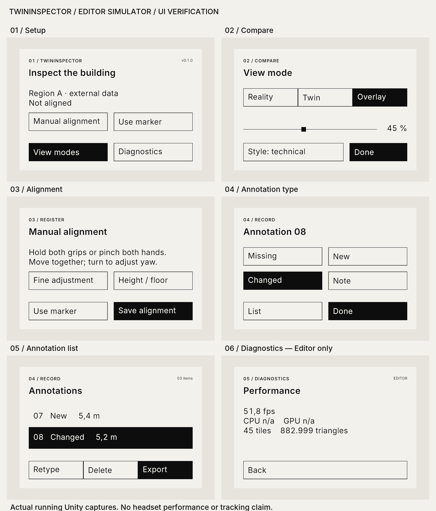
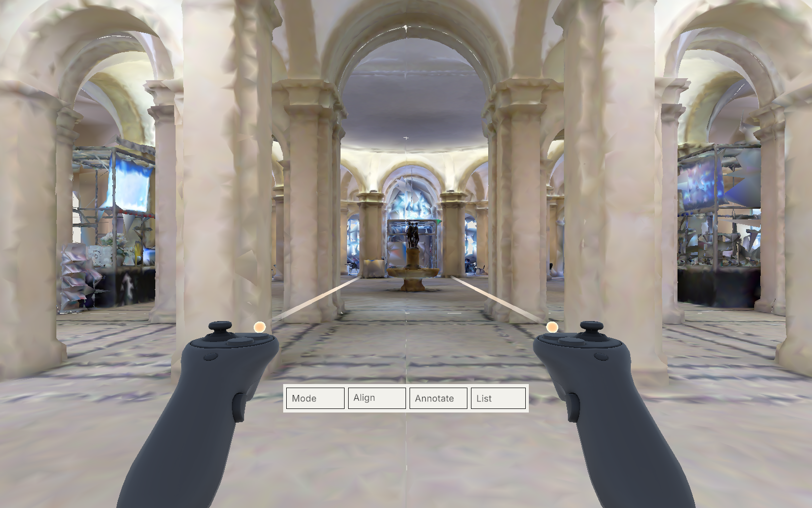

# TwinInspector design system

Swiss / International Typographic Style: opaque paper, ink typography, square controls, explicit words, one active red accent and a consistent 8 mm rhythm. The contact sheet below contains actual captures of the running Editor simulator.

## Tokens and physical scale

| Token | sRGB | Role |
|---|---|---|
| Ink | `#111111` | Text, rules and primary controls |
| Paper | `#F2F1EC` | Opaque panel background |
| Paper 2 | `#E6E4DD` | Secondary surfaces / twin-only background |
| Muted | `#6F6E69` | Non-text separators and disabled controls |
| Accent / Missing | `#E30613` | Active action / missing geometry |
| New | `#0046E6` | New geometry annotation |
| Changed | `#F2B600` | Changed geometry annotation, ink label |
| Note | `#6F6E69` | Note annotation |
| Twin tint | `#C4C9CC` before surface shading | Neutral Technical overlay fill |
| Twin edge | Ink | Creases and view-dependent silhouettes |

Text uses ink on paper (or paper on ink), including secondary text: the provided muted colour does not meet the brief's 7:1 text contrast requirement. Annotation colours communicate type but their labels use ink/paper.

Panel space is millimetres, at a world scale of 0.001. Standard panel 480 × 320 mm; outer margin 24, gutter 16, controls 48 high, square slider handle 12, separator rules 1. Long content scrolls, with the bounded type fitting described below. The panel and strip share a gravity-aligned world dock; a qualified palm gesture summons it once. No head-locked panels.

## Typography and legibility resolution

Inter 4.1, SIL OFL. Regular 400, Medium 500, SemiBold 600. TextMeshPro SDF atlases: 2048², sampling 64, padding 8. Numeric readouts use tabular figures. No default UI sprites or fallback system typefaces.

The brief's nominal 12 mm body is only 0.69° at 1 m, below its own 1.2° minimum. Therefore body/control text is **21 mm**, with 32 mm display, 24 mm title, 12 mm uppercase section labels with 6% tracking and 10 mm metadata. Body line height is 1.3. Layouts paginate/scroll to preserve readable body size. Scale the entire panel by viewing distance if spawned farther away.

## Components and state

v1.3 retains the fixed 480 × 320 layout. Button and row text auto-sizes from 21 to a minimum of **16**; strip words use **12–16**. Slider headings use 19 in their 24 mm rect. Buttons never wrap. Two-line guide bodies use full terminology; short button abbreviations follow the [four-language glossary](../../doc/PROMPT_TwinInspector_v1.3.md#73-glossary). The six guide cards each give one sentence and one action to try, with Skip/Back/Next or Done. Only Skip/Done completes onboarding.

All visible labels are resource-backed English/German/French/Italian. `ProjectBuilder.UiCharacters()` collects every table character when rebuilding the Inter atlases, including accents, umlauts, punctuation and ². Resource slot limits and actual TMP layout are tested independently. English/German glossary review was performed by the implementation agent; French/Italian are marked machine translated, unreviewed.

Candidate patches use the existing type colours at 35% opacity with an ink outline and a hollow glyph. Confirmed regions use 25% opacity and persist with their annotations. Patches obey Lens visibility and share a global 50,000-triangle cap. Candidate selection offers Confirm/Dismiss. Pick object is an experimental action requiring an enabled evaluation build and verified external models; the v1.3 release disables it because scheduling exceeds its frame budget. Long-running inference has a visible processing message and cancels when its context changes. Background candidate updates preserve the list's scroll position and defer rebuilding while the pointer hovers or drags.

One PanelBase supplies paper, header, content area and bottom toast. Buttons invert immediately on hover/focus; selected segments are ink filled. There are no radii, shadows, gradients, decorative illustrations or icon fonts. Show/hide motion lasts 150 ms, at most 20 mm. The four tool-strip actions are Mode, Align, Annotate, List.

Annotations use type-specific geometry and symbols (circle/minus, square/plus, triangle/delta, diamond/dot), a short numbered label and a surface leader. Their presentation grows with distance to retain at least 1.5° angular height at 10–30 m, while the stored anchor and normal remain fixed. Selected annotations invert; list selection provides a directional cue. Annotation and candidate types share the same semantic colour set.

Colour style renders the dataset's sampled vertex colour. Technical style uses neutral surface shading, restrained concavity, cached crease/silhouette edges and original-frame elevation contours. Shared clipping keeps fill, outlines, contours and the datum grid inside the Lens. Blend is a global shader property, with no per-renderer updates. Twin-only uses an opaque paper-2 background and a metre grid.

## Verification

Verified the running setup, view-mode, alignment, type-picker, annotation-list and diagnostics panels. The blend handle is 12 mm square, two complete annotation rows occupy the scroll viewport, and the tool strip is 560 × 64 mm to keep all four action names legible. The Inter SDF assets are bundled; numeric glyph advances are explicitly equalized because this TextMeshPro version does not apply the font's OpenType tabular substitution at runtime.

The hall capture uses the real Region A tiles and simulated controllers. It verifies a useful initial viewpoint and scene rendering, not headset tracking, surface accuracy, readability through headset optics or frame rate. Capture helpers are in `tools/unity/`; `tools/contact_sheet.py` assembles the six unchanged panel images.
